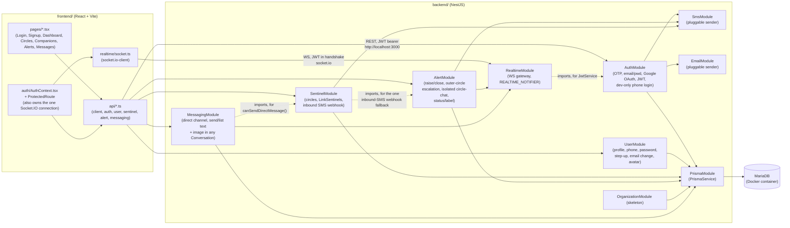

# Stack schema

Updated: 2026-10-28 14:01

Conceptual overview of the whole MySentinelCircle stack — how the pieces fit together. For DB entities/relations see `backend/prisma/DB_schema.md`; for route-by-route detail see `API.md`.

domain name: mysentinelscircles.com.

## Tech stack

- **Backend**: NestJS + TypeScript
- **Frontend web**: React + TypeScript (Vite), i18next for translations
- **Mobile**: React Native (planned, not started)
- **ORM / DB**: Prisma + MariaDB, containerized (self-hosted, not a managed provider like Neon)
- **SMS**: pluggable provider behind an interface (`SMS_SENDER`/`OTP_SENDER`/`EMAIL_SENDER` tokens). Dev sender logs to console and, if `NOSMSNOW_URL` is set (`backend/.env`), also forwards to NoSMSNow (`nosmsnow/`, a dev-only proxy tool — not a real provider) so outbound OTP/SMS/email shows up there. One inbound webhook for the whole app, `POST /sentinel/sms/inbound` (mirrors how a real provider gives one inbound URL per phone number, not one per module) — lets a Sentinel without an account answer by SMS (OUI/NON/STOP). `SentinelService.handleInboundSms` tries its own sentinel-link-domain matches first (pending invite/request, then a 1st-circle move proposal), then delegates to `AlertService.tryHandleInboundSms` for a live alert ask (`sentinel` imports `AlertModule` for this one call — the single deliberate exception to "one module per concern"), and only then falls back to its own blanket "NON/STOP means leave". Twilio likely default in prod.
- **Real-time**: Socket.IO, built (`backend/src/realtime/`, `@nestjs/websockets` + `@nestjs/platform-socket.io`). One gateway, push-only — no `@SubscribeMessage` handlers, clients never send app data over the socket. JWT-authenticated handshake (same secret/payload as `JwtStrategy`, verified manually since the socket.io handshake doesn't go through Nest's HTTP guard pipeline), one room per user (`user:<id>`). `AlertService`/`MessagingService` push through a `REALTIME_NOTIFIER` interface (mirrors the `SmsSender`/`OTP_SENDER` pattern) rather than depending on socket.io directly — `notifyNewMessage`/`notifyAlertChanged` emit a bare id (`message:new { conversationId }`, `alert:changed { alertId }`); the client still calls the existing `GET` endpoints for the actual content, the socket is just the "go refetch" signal, so there's only ever one authorization-aware code path (`getAlert()`) regardless of how a client learned something changed. SMS notifications (`notifyParticipants` in `alert.service.ts`) are unchanged and still go out alongside the WS push, for anyone not connected.
- **Rate limiting**: `@nestjs/throttler`, **implemented**. A single global default guard (`ThrottlerModule.forRoot([{ ttl: 60_000, limit: 20 }])` + `APP_GUARD` → `ThrottlerGuard`, both in `app.module.ts`) covers every route at 20 req/min/IP; `auth`'s routes additionally carry `@Throttle({ default: { limit: 5, ttl: 60_000 } })` (5 req/min/IP) since signup/login/OTP/password-reset are the brute-force-sensitive surface, as does the dev-only `POST /auth/dev-login`. No custom `RateLimitGuard`, no separate `*.documentation.ts` files — simpler than originally sketched. `alert`/`messaging` have no route-specific throttling yet — just the global default.
  Lesson from transcendance: behind nginx, the backend saw every client as the same IP, so concurrent signups all shared one throttle bucket and got blocked. Fix: nginx must set `X-Forwarded-For`/`X-Real-IP` (done, every `nginx/nginx.conf` location block sets it), NestJS must `app.set('trust proxy', 1)` (done, in `main.ts`). Throttling still keys on IP, not on the target identifier (phone/account) — several real users can legitimately share one IP (school network, hotel Organization Sentinels); not hardened yet.
- **API docs**: Swagger (`@nestjs/swagger`), dev-only. `main.ts` mounts `SwaggerModule` at `/docs` guarded by `process.env.NODE_ENV !== 'production'` — never exposed in prod, and not reachable through nginx in Docker mode either (no `location /docs` block; would need one added to the locked `nginx.conf` if ever wanted there). DTOs across `auth` are decorated with `@ApiProperty()`; other modules have none yet (still skeletons).
- **CI**: GitHub Actions, `.github/workflows/backend-ci.yml`. Runs on every push/PR to `main`/`dev`: `npm run lint`, `npm run test` (unit), `npm run test:e2e` — against an ephemeral MariaDB 11 service container (not Sylvie's local Docker), so it never touches real data. See `TEST.md` for the full test strategy (unit vs e2e, local `mysentinelcircle_test` DB, how to run each).
- **Infra**: Docker + `docker-compose` (pattern reused from the transcendance project, adapted — see `PERMISSIONSCLAUDE.md`, these files are now `deny`-locked). Root `docker-compose.yml` runs 4 services: `mariadb` (named volume, persists across restarts), `backend`, `frontend`, `nginx` (reverse proxy, self-signed HTTPS). Two ways to run locally:
  - **Host mode** (`make dev`): backend on `:3000`, frontend on `:5173`, both on the bare host — the original simple flow, still works unchanged.
  - **Docker mode** (`make docker-up`, after `make certs` once): full stack in containers, reachable through nginx at `https://localhost:4444` (HTTP `:8081` redirects to it). `backend`/`frontend` containers publish no ports — only reachable via nginx — so both modes can run at once without colliding, sharing only the `mariadb` container/volume. nginx routes one location block per backend module prefix (`/auth/`, `/user/`, `/sentinel/`, `/alert/`, `/organization/`, `/messaging/`), plus `/uploads/` (avatars and message images, served by the backend's `useStaticAssets`, not nginx itself) and `/socket.io/` (WS upgrade headers set, proxied through to the realtime gateway) straight through to `backend:3000`, no `/api` prefix. The frontend's `VITE_API_URL` is overridden to `""` in Docker mode so every API call (and the socket.io connection) becomes same-origin relative through nginx — no frontend code change needed. Cert is self-signed (`make certs`, gitignored) — browsers show a "not private" warning, expected until a real domain is involved.
  **Gotcha, hit for real on 2026-10-28**: `nginx.conf` is baked into the nginx image at build time (`COPY nginx.conf /etc/nginx/nginx.conf` in `nginx/Dockerfile`), not bind-mounted — editing it on disk changes nothing in a running container until `docker compose build nginx && docker compose up -d nginx`. The `/uploads/` block had been committed for months with the image never rebuilt, so avatar uploads (and now message images) silently 404'd-via-frontend-fallback through nginx the whole time despite working fine directly against the backend. If something in `nginx.conf` "isn't working" in Docker mode, check whether the image actually matches the file before suspecting the config itself.
- **Hosting**: 42 Lausanne VM (`vod.42lausanne.ch`) for first tests with real users; planned migration to Infomaniak (Node.js hosting) for the stable public launch — same containerized MariaDB carries over unchanged, Infomaniak includes MariaDB free in that plan.

## High-level diagram

## Backend modules

One NestJS module per concern (`backend/src/`), per `plan.txt`'s BACKEND MODULES section:

| Module | Role | Status |
|---|---|---|
| `auth` | Login/signup: phone+OTP, email+password, Google OAuth; issues JWT sessions. Kept separate from `user` so auth strategies evolve independently of profile data. | Implemented (controller, service, JWT strategy/guard, OTP sender interface) |
| `user` | Profile read/update, avatar upload, add/verify a phone, change password, step-up re-authentication (password/Google/code) before a sensitive action, email-change request+confirm flow. | Implemented (`UserController` + separate unguarded `EmailConfirmationController`, service) |
| `sentinel` | Register Sentinels (invite or request), define circles (incl. the system-managed `FIRST`/`RESERVED` circles), per-Sentinel settings (`sentinelType` — Lead/FirstCircle/Sentinel/Sentinel SMS —, Lead-slot, messaging settings `canMessageOwnCircle`/`firstCircleMessagingMode`). Keeps the 1st circle's Lead slot(s) covered; relocates a closing circle's members to the reserve circle instead of blocking deletion. Also owns the one inbound-SMS webhook for the whole app, delegating to `alert` for a live alert reply. | Implemented (controller, service, SMS-based sub-controller, unit + e2e tests) |
| `alert` | Raise/close an alert (by "Me" or any accepted Sentinel, any circle for raising; only "Me" or the 1st circle for closing); outer-circle escalation (the 1st circle asks one specific outer circle a yes/no question, by SMS or in-app); an isolated chat an authorized outer-circle Sentinel can open with the 1st circle once solicited (`GET /alert/:id/circle-chat`, one per requester, never shared); a shared live status per side (`statusByCompanion`/`statusByFirstCircle`) and an alert name (`label`), both attributed to their last writer; a lightweight read path (`my-participation`) for solicited outer-circle Sentinels that never exposes who else was contacted. SMS notifications stay as before; every mutation also pushes `alert:changed` over WS to the companion and every current participant. | Implemented (controller, service, unit + e2e tests) |
| `organization` | Authenticate the `OrganizationMember`, look up a target user by phone, raise an alert (with reason), notify the 1st circle, open the Organization↔1st-circle `Conversation`. | Skeleton |
| `messaging` | Three `Conversation` kinds: the permanent Me<->Sentinel channel (`GET /messaging/direct/:userId`, lazily created, gated by a `User.allowMessagingByDefault` → `Circle.canMessageMe` → `LinkSentinels.canMessageMe` cascade resolved at read time, most-specific-non-null wins, never a bulk rewrite when the default changes), plus the two `alert`-owned kinds (1st-circle group chat, isolated outer-circle chat) it only sends/lists into, never creates. Send/list cover both `TEXT` (JSON body) and `IMAGE` (multipart upload, mirrors `user`'s avatar pattern, stored under `uploads/messages/`) through one shared `createMessage()`. The companion is deliberately never a `ConversationParticipant` of either `alert`-owned kind; they instead read the full history embedded in `alert`'s own `GET /alert/:id` response. Every send pushes `message:new` over WS to each active participant. | Implemented (controller, service, unit + e2e tests) |
| `realtime` | Socket.IO gateway (push-only, no inbound client messages) + the `REALTIME_NOTIFIER` interface `alert`/`messaging` inject to push without depending on socket.io types directly. JWT-authenticated handshake, one room per user. `@Global()`, like `sms`/`email`, so no other module needs to import it to use the token — it does import `AuthModule` itself, for `JwtService`. | Implemented (gateway, module, unit tests) |
| `sms` | Pluggable SMS sender behind `sms-sender.interface.ts` (console sender in dev). Used by `auth` (OTP) and will be used by `alert`. | Implemented |
| `email` | Pluggable email sender behind `email-sender.interface.ts` (`EMAIL_SENDER` token, console sender in dev — same pattern as `sms`). Used by `auth` for password-reset links. | Implemented |
| `prisma` | Wraps `PrismaService` for DB access, injected into every module above. | Implemented |

Skeleton = empty controller/service, module wired into `app.module.ts` but no logic yet — the schema (`schema.prisma`) was reworked ahead of these.

## Frontend structure

- `pages/` — one component per route: `LoginPage`, `SignupPage`, `ForgotPasswordPage`, `ResetPasswordPage`, `OtpVerifyPage`, `ConfirmEmailChangePage`, `DashboardPage`, `CirclesPage`, `CompanionsPage`, `AlertsPage`, `MessagesPage`, `SettingsPage`. `AlertsPage.tsx` and `MessagesPage.tsx` each have their own local `ConversationThread`/`ChatPanel` chat-UI component (messages list + input + its own `message:new` listener) — kept separate by choice rather than extracted into one shared component across files.
- `auth/AuthContext.tsx` + `ProtectedRoute.tsx` — holds the JWT/session, gates routes. `AuthContext` also owns the single Socket.IO connection for the whole logged-in session (connects when `user` becomes non-null, disconnects on logout), exposed through the same `useAuth()` hook as `user`/`logout`.
- `realtime/socket.ts` — `createSocket(token)`, a thin `socket.io-client` wrapper (same-origin by default, so nginx's `/socket.io/` proxy handles it in Docker mode with zero config).
- `api/client.ts` — thin `fetch` wrapper (`apiGet/Post/Patch/Delete/PostForm`), attaches `Authorization: Bearer <token>` from `localStorage`, throws `ApiError` on non-2xx; exports `API_URL` too, for building `/uploads/...` image URLs outside the wrapper. `api/auth.ts`, `api/user.ts`, `api/sentinel.ts`, `api/alert.ts`, and `api/messaging.ts` layer typed calls on top, one file per backend module consumed so far.
- `components/` — shared UI (`AppShell`, `LanguageSwitcher`, `GoogleSignInButton`, `Modal`, `StepUp`).
- `i18n/` — i18next setup + `locales/`.

## How frontend and backend connect

- Frontend calls the backend over REST at `VITE_API_URL` (defaults to `http://localhost:3000` in host mode; overridden to `""` in Docker mode so calls are same-origin through nginx). Backend CORS is locked to `FRONTEND_URL` (defaults to `http://localhost:5173`; only exercised in host mode — same-origin requests through nginx don't trigger CORS at all).
- Auth: OTP/email/Google flows hit `auth` endpoints, get back a JWT, stored in `localStorage` and attached as a bearer token on every subsequent call; `JwtAuthGuard` + `JwtStrategy` protect routes backend-side, `ProtectedRoute` gates pages frontend-side. Dev-only `POST /auth/dev-login` (phone only, no password/OTP) backs a quick-login box on `LoginPage`, compiled out of production builds via `import.meta.env.DEV`.
- Real-time: Socket.IO (see the Real-time bullet above) — `AuthContext` connects once per session; `AlertsPage`/`MessagesPage` each listen for `message:new`/`alert:changed` and refetch over the same REST endpoints they'd otherwise poll, rather than trusting anything in the socket payload directly.
- Each backend module a page needs gets its own `api/<module>.ts` file frontend-side — all five backend modules with real logic (`auth`, `user`, `sentinel`, `alert`, `messaging`) now have one.
- All modules share one `PrismaService` → one MariaDB DB, containerized alongside backend/frontend/nginx via `docker-compose`; no service-to-service DB split.

## Regenerating this file

Run `/docu stack`. Keep it conceptual — update `API.md` (`/docu api`) for endpoint-level detail and `backend/prisma/DB_schema.md` (`/docu prisma`) for entity/relation detail.
