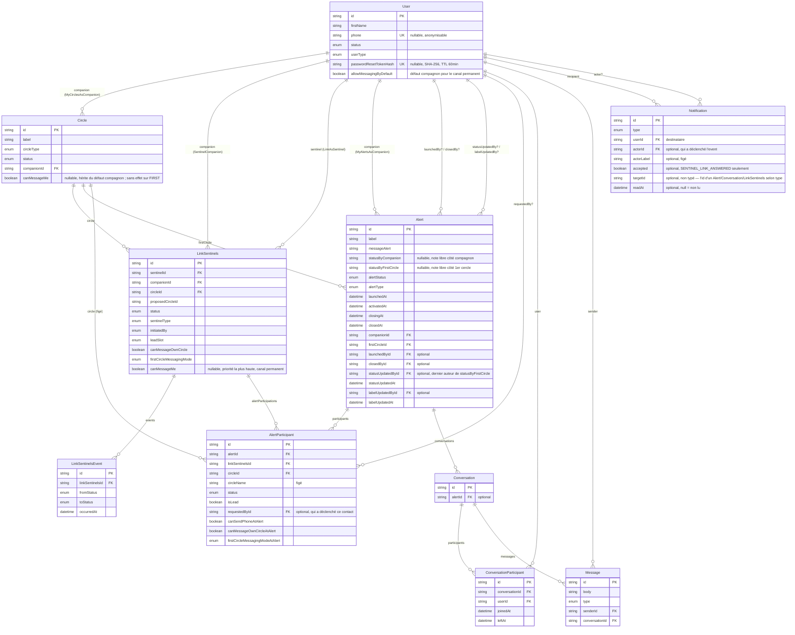
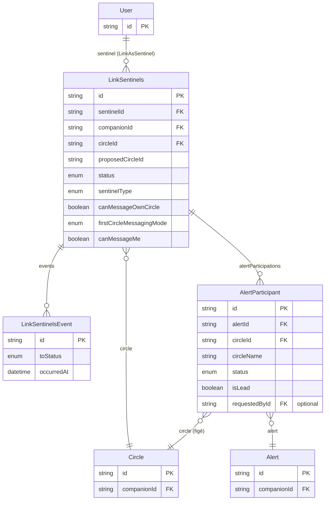
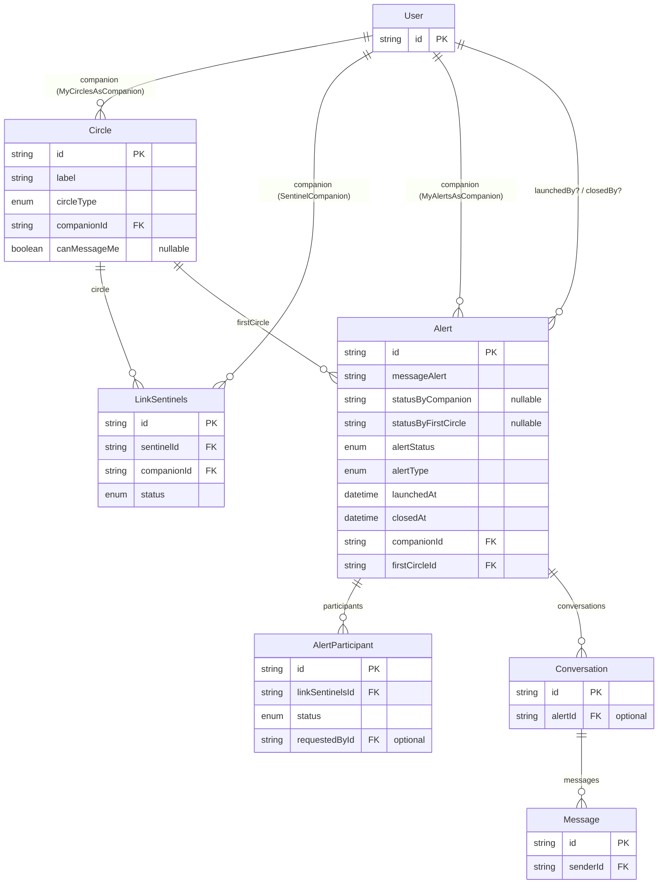
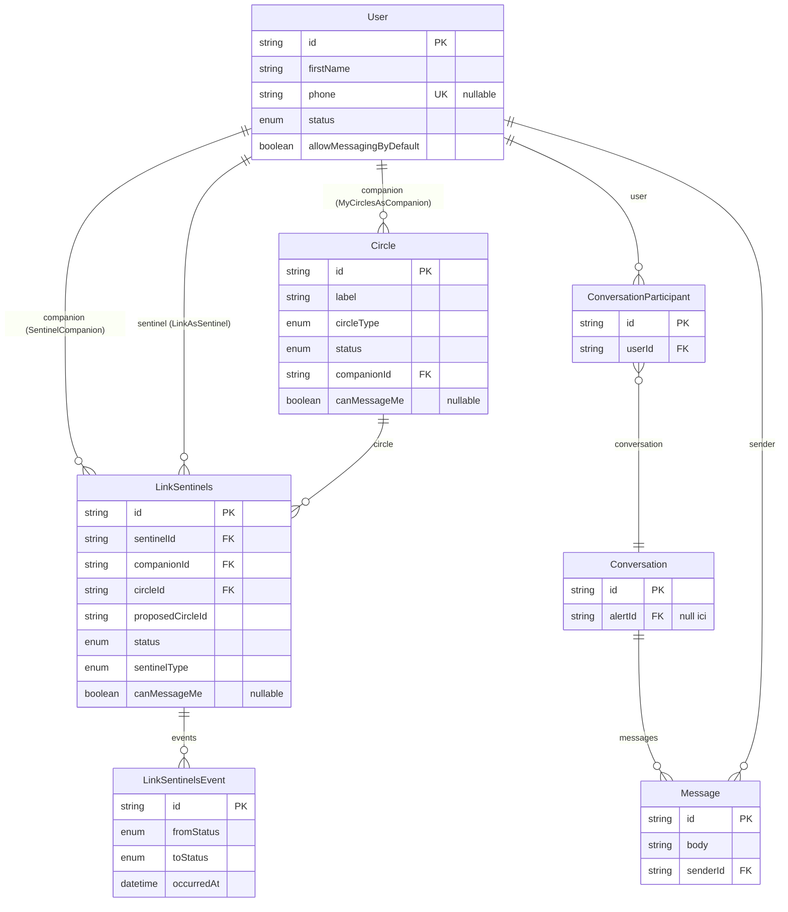
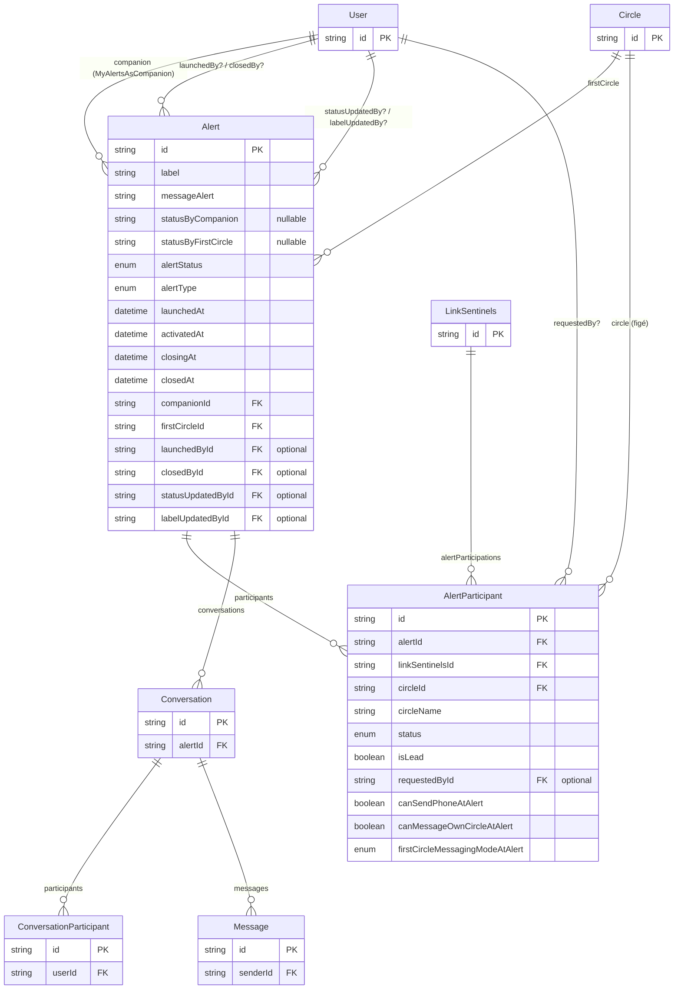

## Database Schema

Updated: 2026-10-28 15:57

> Reflète l'état actuel de `schema.prisma` (branche `sentinels`).

Modèles actifs : `User`, `Circle`, `LinkSentinels`, `LinkSentinelsEvent`, `Alert`, `AlertParticipant`, `Conversation`, `ConversationParticipant`, `Message`, `Notification`.
Principe central : rien n'est jamais vraiment supprimé — `User`/`Circle`/`LinkSentinels` se ferment ou s'anonymisent, mais restent référençables pour toujours. Pas de tables-copies (`CircleAlert`/`LinkSentinelAlert` n'existent plus), pas de journal d'événements séparé (`AlertEvent` a été remplacé par des timestamps d'étape directement sur `Alert`).

---

## Vue "Sentinel"

Ce que `User` touche quand il agit **comme sentinelle**.

- `LinkAsSentinel` : les cercles où ce `User` est enregistré comme sentinelle.
- `AlertParticipant.requestedById` : qui a déclenché ce contact précis — "Me" qui s'auto-alerte, une autre sentinelle qui lève l'alerte en son nom, ou qui dans le 1er cercle a sollicité ce cercle extérieur via `requestCircle`. Visible uniquement par le compagnon et le 1er cercle (`GET /alert/:id`) — jamais par les autres sentinelles sollicitées, qui ne savent pas qui d'autre a été contacté.
- `alertParticipations` : l'historique de toutes les alertes où ce `User` a été sollicité — via son `LinkSentinels`, sans copier son identité. `circleId`/`circleName` figent le cercle tel qu'il était à ce moment, car `LinkSentinels.circleId` peut changer après coup.
- `canMessageOwnCircle` (bool, défaut `true`) / `firstCircleMessagingMode` (`NONE`/`INDIVIDUAL`/`GROUP`, défaut `NONE`) : réglages *liés à une alerte* posés par "Me" sur ce lien — respectivement la capacité de cette sentinelle à échanger avec le reste de son propre cercle pendant une alerte, et sa capacité à ouvrir un chat isolé avec le 1er cercle une fois sollicitée (`GET /alert/:id/circle-chat` ; `GROUP` se comporte aujourd'hui comme `INDIVIDUAL`, pas encore différencié). Ne concernent que les sentinelles avec compte — sans objet pour une Sentinel SMS (`userType ONLY_SMS`), qui reste limitée aux réponses prédéfinies. Figés au moment T sur `AlertParticipant.canMessageOwnCircleAtAlert`/`firstCircleMessagingModeAtAlert` quand une alerte démarre ou qu'un cercle est sollicité — modifier le réglage après coup n'affecte jamais une alerte déjà en cours.
- `LinkSentinels.canMessageMe` : réglage *hors alerte*, distinct des deux ci-dessus — autorise ou bloque le canal permanent Me↔Sentinel (`GET /messaging/direct/:userId`) pour ce lien précis. `null` = hérite de `Circle.canMessageMe`, qui lui-même hérite de `User.allowMessagingByDefault` si `null` — le réglage le plus spécifique l'emporte, résolu à la lecture (`SentinelService.canSendDirectMessage()`), jamais réécrit en masse quand le défaut change (un changement de défaut n'efface jamais une dérogation déjà posée). Toujours autorisé sur le 1er circle, sans dérogation possible.
- Ce `User` reçoit aussi des `Notification` comme destinataire (invitation/demande reçue, réponse à l'une d'elles, alerte levée/élargie/répondue/clôturée le concernant) — voir le modèle `Notification` dans le diagramme global ci-dessus et la légende en bas de page.

## Vue "Companion"

Ce que `User` touche quand il agit **comme companion**.

- `MyCirclesAsCompanion` : les cercles que ce `User` possède.
- `MyAlertsAsCompanion` : les alertes que ce `User` a déclenchées.
- `firstCircle` sur `Alert` pointe directement sur `Circle` (permanent) — plus besoin de snapshot.
- `Alert.launchedBy`/`closedBy` pointent directement sur `User` — couvre aussi bien le cas où c'est le companion lui-même (`AlertType.BYCOMPANION`) que le cas où c'est une sentinelle.
- `statusByCompanion`/`statusByFirstCircle` : deux notes de statut libres et indépendantes, pas un champ partagé — le compagnon écrit la première, n'importe quelle sentinelle acceptée du 1er cercle écrit la seconde (`statusUpdatedBy`/`statusUpdatedAt` gardent trace du dernier auteur côté 1er cercle uniquement — côté compagnon, l'auteur est toujours évident). Les deux restent modifiables même après que l'alerte soit `RESOLVED`, contrairement au chat du 1er cercle qui se verrouille à la fermeture de sa `Conversation`. Visibles par tout le monde, y compris les sentinelles de cercles extérieurs sollicitées (via `GET /alert/:id/my-participation`), qui ne voient en revanche jamais la liste des autres participants.
- `circleType` (`BASIC | FIRST | ORGANISATION | RESERVED`) : `FIRST` et `RESERVED` sont tous deux gérés automatiquement (un seul par companion, créé à la demande, jamais supprimable). `RESERVED` regroupe les liens `LinkSentinels` acceptés mais pas actuellement dans un cercle réel — une sentinelle mise en pause, ou les survivantes d'un cercle supprimé (`deleteCircle` les y déplace au lieu de bloquer la suppression). Une sentinelle n'y atterrit jamais directement à la création (invitation ou demande) — seulement par déplacement manuel ou suppression de cercle.
- `LinkSentinels.proposedCircleId` : référence transitoire (pas une vraie relation Prisma, comme `AlertParticipant.circleId`/`circleName`) posée par `updateMembership` quand "Me" déplace une sentinelle déjà acceptée vers le 1er cercle — le lien reste actif dans son cercle actuel le temps que la sentinelle réponde (`respondToCircleMove`, ou OUI/NON par SMS). Accepté : `circleId` devient `proposedCircleId`, qui repasse à `null`. Refusé : `proposedCircleId` repasse juste à `null`, rien d'autre ne change. Déplacer vers n'importe quel autre cercle (`BASIC`/`RESERVED`) reste immédiat, sans consentement — juste une notification.
- Ce `User` reçoit aussi des `Notification` comme destinataire (alerte levée/élargie/répondue/clôturée le concernant, réponse à une invitation/demande qu'il a lui-même initiée) — voir le modèle `Notification` dans le diagramme global ci-dessus et la légende en bas de page.

---

## Schéma "avant alerte"

Le monde vivant : cercles, liens sentinelles (jamais fermés/recréés, juste transitionnés), leur journal minimal, et la messagerie 1:1 permanente.

Chaque transition de statut (`PENDING→ACCEPTED`, `ACCEPTED→REMOVED`...) crée une ligne `LinkSentinelsEvent` — seule trace d'historique hors alerte, et elle sert aussi de déclencheur de notification ("Anna a quitté ton 1er cercle"). Une conversation hors alerte a `alertId = null` ; on la retrouve en cherchant, via `ConversationParticipant`, une conversation sans alerte partagée par exactement ces 2 users — créée à la volée au premier message (`GET /messaging/direct/:userId`), jamais à l'avance.

Avant de créer/retrouver cette conversation, le droit d'envoyer est résolu via la cascade `LinkSentinels.canMessageMe` → `Circle.canMessageMe` → `User.allowMessagingByDefault` (premier non-`null` rencontré gagne, toujours vrai sur le 1er cercle) — calculée à chaque lecture, jamais stockée ni réécrite en masse : changer le défaut du compagnon ne touche aucune dérogation déjà posée sur un cercle ou un lien précis.

## Schéma "pendant alerte"

Ce qui se déclenche une fois une alerte lancée : qui a participé (référence directe au lien permanent, pas de copie), les étapes franchies, et les conversations scopées à l'alerte.

`AlertParticipant.linkSentinelsId` est obligatoire — il pointe toujours sur le lien vivant, jamais une copie. Le cas "companion s'auto-alerte" (`AlertType.BYCOMPANION`) n'a pas besoin de `AlertParticipant` : `Alert.launchedBy` pointe directement sur `User`. Une alerte peut porter plusieurs `Conversation` (`Alert.conversations[]`, pas de limite à une seule) : le chat de groupe du 1er cercle (créé à `raise`, un seul par alerte), et une par sentinelle de cercle extérieur ayant ouvert un chat isolé avec le 1er cercle (`GET /alert/:id/circle-chat`, une par demandeur, jamais partagée entre demandeurs). Aucune des deux n'est typée en DB — elles se distinguent uniquement par leurs `ConversationParticipant` (présence ou non d'un participant hors 1er cercle), une question de logique backend, pas de schéma. `Message` n'a pas non plus de garde d'accès dédiée pour le compagnon : `GET /alert/:id` inclut directement `conversations[].messages` (et `conversations[].participants`, pour distinguer les genres côté client) dans sa réponse, donnant au compagnon une lecture complète de l'historique de chaque conversation sans qu'il en soit `ConversationParticipant` (il reste 403 sur les routes `messaging` elles-mêmes).

---

## Légende — les différents mécanismes d'historique

- **`LinkSentinels`** : lien vivant User↔Circle, une seule ligne par paire, jamais supprimée — juste son `status` change (`PENDING`/`ACCEPTED`/`REMOVED`/`BLOCKED`...).
- **`LinkSentinelsEvent`** : journal append-only de chaque transition de statut — trace minimale de qui est entré/sorti d'un cercle, indépendamment de toute alerte.
- **`AlertParticipant`** : ce qui s'est passé pour un `LinkSentinels` donné pendant une alerte donnée (contacté, répondu, lead, qui a déclenché ce contact via `requestedById`, réglages de messagerie au moment T via `canSendPhoneAtAlert`/`canMessageOwnCircleAtAlert`/`firstCircleMessagingModeAtAlert`, cercle figé via `circleId`/`circleName`) — remplace l'ancien `LinkSentinelAlert`, sans jamais copier l'identité (nom/téléphone restent uniquement dans `User`).
- **Étapes de l'alerte** : `Alert.launchedAt`/`activatedAt`/`closingAt`/`closedAt` — un timestamp par étape franchie, directement sur `Alert` (pas de table d'événements séparée ; ne garde que le dernier passage si une étape est revisitée).
- **Attribution "dernier auteur"** : `Alert.statusUpdatedById`/`statusUpdatedAt` (côté 1er cercle uniquement — `statusByCompanion` n'a pas besoin d'attribution, son auteur est toujours évident), `Alert.labelUpdatedById`/`labelUpdatedAt`, `AlertParticipant.requestedById` — pas un journal d'événements, juste qui a écrit la valeur *actuelle* en dernier. Choix délibéré de Sylvie (plus simple qu'une table `AlertEvent` dédiée) : pas d'historique complet si une valeur est réécrite plusieurs fois, seulement le dernier passage.
- **`Conversation` / `ConversationParticipant` / `Message`** : fil générique, réutilisable pour n'importe quel groupe de `User` à n'importe quel moment. `alertId` (optionnel) dit juste si elle est scopée à une alerte ou pas — le "genre" de conversation (1:1 permanent, groupe 1er cercle, sentinelle isolée d'un cercle extérieur) n'est pas stocké : il se déduit des participants, côté backend. `Message.type` (`TEXT`/`IMAGE`/`SYSTEM`) : `TEXT` et `IMAGE` sont tous deux en usage — pour `IMAGE`, `body` contient juste le nom de fichier stocké sous `uploads/messages/` (même principe que `User.avatarPath`), jamais une URL complète. `SYSTEM` reste dans l'enum mais rien ne le pose encore.
- **`Notification`** : mécanisme à part des précédents — ce n'est pas un journal du système, juste une boîte de réception persistée par destinataire (`userId`), pour que `message:new`/`alert:changed`/`notification:new` (WebSocket, éphémères — rien n'est gardé si le destinataire n'est pas connecté au moment de l'émission) aient un équivalent durable que le frontend peut lister et marquer lu (`readAt`). Volontairement pas de FK typée vers `Alert`/`Conversation`/`LinkSentinels` : `targetId` est une simple colonne texte, son sens dépend de `type` — même choix que pour les autres règles jugées trop fluides pour une contrainte DB (voir `CLAUDE.md`). `actorId`/`actorLabel` suivent le même principe de gel que `AlertParticipant.circleName` : `actorLabel` fige le nom de l'auteur au moment T, pour ne pas dépendre d'un `User` qui pourrait être renommé/anonymisé ensuite. La création est toujours sautée quand `userId === actorId` (personne n'a besoin d'être notifié de sa propre action).

Anonymisation : quand un `User` supprime son compte, `status → DELETED` + ses champs identifiants sont vidés/anonymisés, mais son `id` reste — `Message.senderId`, `AlertParticipant`, `ConversationParticipant` continuent de fonctionner sans casser l'historique.
