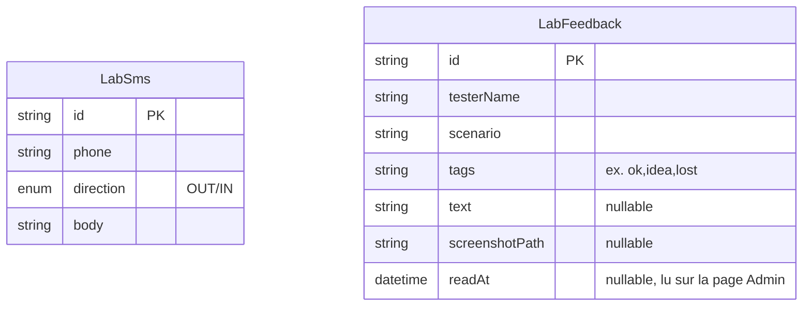
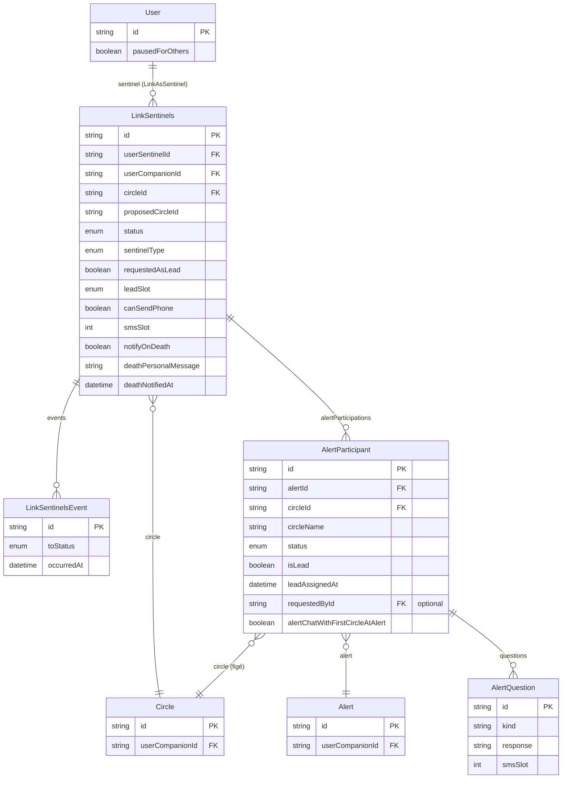
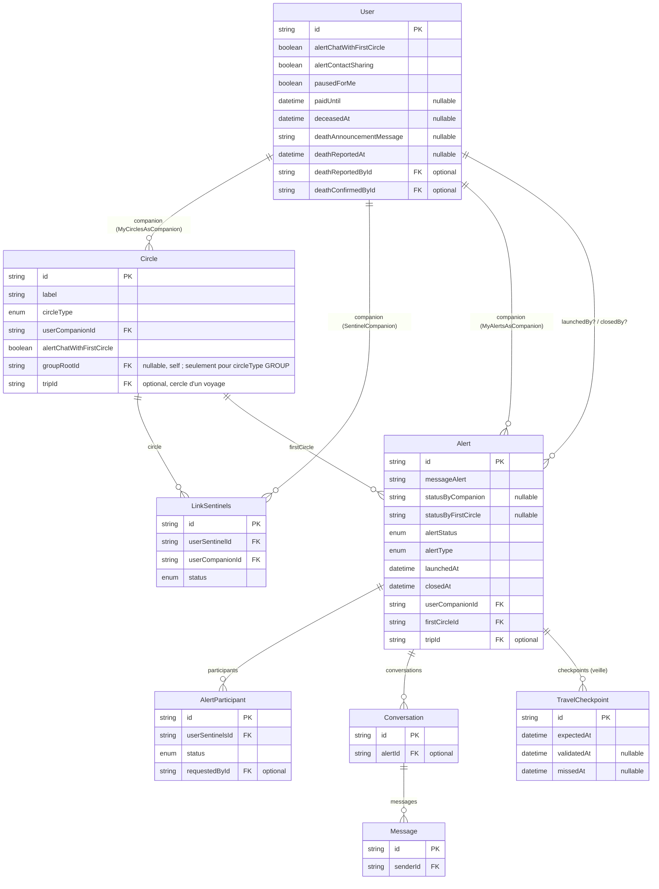
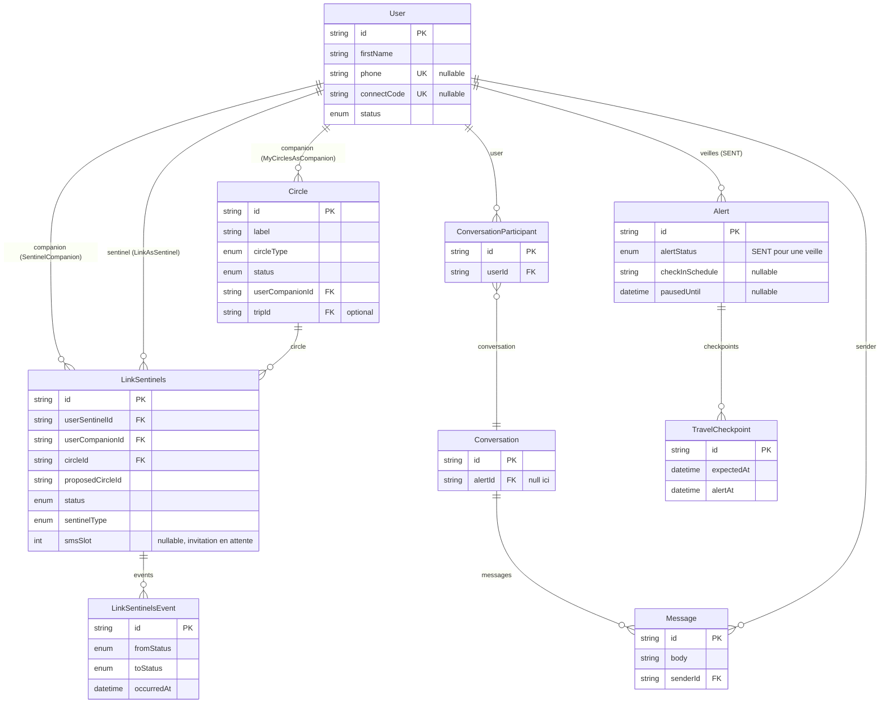
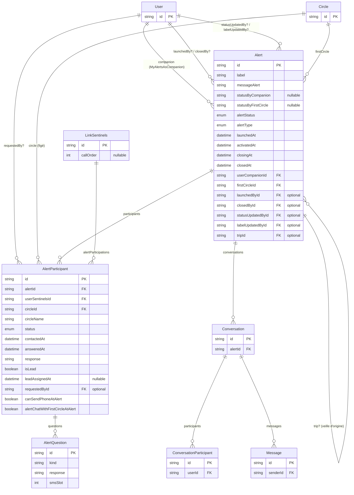

## Database Schema

Updated: 2026-11-11 00:40

> Reflète l'état actuel de `schema.prisma`. Les diagrammes montrent les champs utiles à la compréhension, pas chaque colonne technique (`createdAt`/`updatedAt`, hash d'OTP, etc.).

Modèles actifs : `User`, `Circle`, `LinkSentinels`, `SentinelGroupInvitation`, `LinkSentinelsEvent`, `Alert`, `AlertParticipant`, `AlertQuestion`, `Conversation`, `ConversationParticipant`, `Message`, `Notification`, `TravelCheckpoint`, `LoginEvent`, et pour le labo de test uniquement `LabSms`, `LabFeedback`.
Mode veille (2026-11-10) : une veille (voyage ou Check tout va bien) est un `Alert` en `SENT` pour toute sa vie (`closedAt` = sa fin) ; ses échéances sont des `TravelCheckpoint` ; une échéance manquée ouvre une vraie alerte séparée, liée par `Alert.tripId`. Les cercles du voyage sont des `Circle` avec `tripId`.
Principe central : rien n'est jamais vraiment supprimé — `User`/`Circle`/`LinkSentinels` se ferment ou s'anonymisent, mais restent référençables pour toujours. Pas de tables-copies (`CircleAlert`/`LinkSentinelAlert` n'existent plus), pas de journal d'événements séparé pour l'alerte (des timestamps d'étape directement sur `Alert`).

```mermaid
erDiagram
  User               ||--o{ Circle                   : "companion (MyCirclesAsCompanion)"
  User               ||--o{ LinkSentinels            : "companion (SentinelCompanion)"
  User               ||--o{ LinkSentinels            : "sentinel (LinkAsSentinel)"
  User               ||--o{ Alert                    : "companion (MyAlertsAsCompanion)"
  User               ||--o{ Alert                    : "launchedBy? / closedBy? / paidBy?"
  User               ||--o{ Alert                    : "statusUpdatedBy? / labelUpdatedBy?"
  User               ||--o{ AlertParticipant          : "requestedBy?"
  User               ||--o{ AlertQuestion             : "askedBy"
  User               ||--o{ ConversationParticipant  : "user"
  User               ||--o{ Message                  : "sender"
  User               ||--o{ Notification             : "recipient"
  User               ||--o{ Notification             : "actor?"
  User               ||--o{ LoginEvent                : "loginEvents"
  User               ||--o{ User                      : "deathReportedBy? / deathConfirmedBy? (self)"
  User               ||--o{ SentinelGroupInvitation    : "invited / invitedBy"
  Circle             ||--o{ LinkSentinels             : "circle"
  Circle             ||--o{ Alert                     : "firstCircle"
  Circle             ||--o{ AlertParticipant           : "circle (figé)"
  Circle             ||--o{ Circle                     : "groupRoot? (self, GROUP)"
  Circle             ||--o{ SentinelGroupInvitation    : "groupInvitations"
  LinkSentinels      ||--o{ LinkSentinelsEvent        : "events"
  LinkSentinels      ||--o{ AlertParticipant          : "alertParticipations"
  Alert              ||--o{ AlertParticipant          : "participants"
  AlertParticipant   ||--o{ AlertQuestion             : "questions"
  Alert              ||--o{ Conversation              : "conversations"
  Conversation        ||--o{ ConversationParticipant  : "participants"
  Conversation        ||--o{ Message                  : "messages"
  Alert              ||--o{ TravelCheckpoint          : "checkpoints (TripCheckpoints)"
  Alert              ||--o| TravelCheckpoint          : "openedByCheckpoint (CheckpointOpenedAlert)"
  Alert              ||--o{ Alert                     : "trip? (self, TripAlerts)"
  Alert              ||--o{ Circle                    : "tripCircles (TripCircles)"

  User {
    string id PK
    enum   status "ACTIVE/DELETED/DECEASED"
    enum   userType "ONLY_SMS/ACCOUNT/ORGANISATION/UNCOMPLETE"
    string firstName
    string lastName "nullable"
    string email UK "nullable"
    string phone UK "nullable, anonymisable"
    datetime phoneVerifiedAt "nullable"
    string pendingPhone "nullable, changement ou récupération de téléphone"
    datetime phoneRecoveryRequestedAt "nullable, téléphone perdu"
    string phoneRecoveryConfirmedById "nullable, 1re confirmation du 1er cercle"
    string language "nullable, fr/en (textes et SMS)"
    string timeZone "nullable, IANA, envoyé par le navigateur (Mode veille)"
    enum   gender "nullable, FEMALE/MALE/NEUTRAL (accords des textes)"
    string connectCode UK "nullable, code du QR code"
    boolean alertChatWithFirstCircle "interrupteur général : mes cercles extérieurs peuvent écrire au 1er cercle pendant une alerte"
    boolean alertContactSharing "coordonnées autorisées dans mes chats d'alerte"
    boolean pausedForMe "personne ne peut lancer d'alerte sur moi"
    boolean pausedForOthers "je ne suis pas sollicité.e pour les autres"
    datetime paidUntil "nullable, abonnement"
    datetime deathNoticePurchasedAt "nullable"
    datetime sessionsValidAfter "nullable, déconnexion partout"
    datetime termsAcceptedAt "nullable"
    datetime deceasedAt "nullable, posé à la 2e confirmation"
    string deathAnnouncementMessage "nullable, rédigé par Me de son vivant"
    datetime deathReportedAt "nullable, signalement en attente"
    string deathReportedById FK "optional"
    string deathConfirmedById FK "optional, doit différer du reporter"
  }

  Circle {
    string id PK
    string label
    enum   circleType "BASIC/FIRST/ORGANISATION/RESERVED/GROUP"
    enum   status "ACTIVE/CLOSED"
    datetime closedAt "nullable"
    string userCompanionId FK
    boolean alertChatWithFirstCircle "ce cercle peut écrire au 1er cercle pendant une alerte ; sans effet sur FIRST"
    string groupRootId FK "nullable, self ; null = ce Circle EST la racine du groupe"
    string tripId FK "optional, cercle d'un voyage (Mode veille)"
  }

  LinkSentinels {
    string id PK
    string userSentinelId FK
    string userCompanionId FK
    string circleId FK
    string proposedCircleId "nullable"
    enum   status "PENDING/ACCEPTED/DECLINED/REMOVED/BLOCKED"
    enum   sentinelType
    enum   initiatedBy "COMPANION/SENTINEL"
    boolean requestedAsLead
    enum   leadSlot "nullable, LEAD_1/2/3"
    int    callOrder "nullable, rang d'appel manuel en cercle extérieur"
    boolean canSendPhone "défaut false ; seulement figé sur AlertParticipant, lu nulle part"
    int    smsSlot "nullable, code de réponse SMS 1<slot> d'une invitation"
    boolean notifyOnDeath
    string deathPersonalMessage "nullable"
    datetime deathNotifiedAt "nullable"
  }

  SentinelGroupInvitation {
    string id PK
    string groupRootId FK
    string invitedUserId FK
    string invitedById FK
    enum   status "LinkStatus"
  }

  LinkSentinelsEvent {
    string id PK
    string userSentinelsId FK
    enum   fromStatus "nullable"
    enum   toStatus
    datetime occurredAt
  }

  Alert {
    string id PK
    string label
    string messageAlert
    string statusByCompanion "nullable"
    string statusByFirstCircle "nullable"
    enum   alertStatus "SENT/LAUNCHED/ACTIVE/CLOSING/RESOLVED"
    enum   alertType
    datetime launchedAt
    datetime activatedAt
    datetime closingAt
    datetime closedAt
    string userCompanionId FK
    string firstCircleId FK
    string launchedById FK "optional, null = ouverte par l'app (veille)"
    string closedById FK "optional"
    string paidById FK "optional, qui a payé cette alerte"
    string statusUpdatedById FK "optional"
    datetime statusUpdatedAt
    string labelUpdatedById FK "optional"
    datetime labelUpdatedAt
    string tripId FK "optional, alerte ouverte par une échéance de veille manquée"
    boolean shareItineraryWithFirstCircle "veille : le 1er cercle voit le voyage"
    boolean shareValidationsWithFirstCircle "veille : idem (cochés ensemble)"
    string checkInSchedule "nullable, Check tout va bien : rythme en JSON"
    datetime pausedUntil "nullable, veille en pause jusqu'à"
  }

  TravelCheckpoint {
    string id PK
    string alertId FK "la veille"
    datetime expectedAt
    datetime alertAt "expectedAt + délai"
    string placeName "nullable"
    float latitude "nullable"
    float longitude "nullable"
    datetime remindedAt "nullable"
    datetime validatedAt "nullable"
    float validatedLatitude "nullable"
    float validatedLongitude "nullable"
    string validatedPlace "nullable, ailleurs : où"
    string validatedNote "nullable, journal de bord"
    datetime missedAt "nullable"
    string openedAlertId FK "optional, unique, l'alerte ouverte"
  }

  AlertParticipant {
    string id PK
    string alertId FK
    string userSentinelsId FK
    string circleId FK
    string circleName "figé"
    enum   status "WAITING/CONTACTED/RESPONDED/ACTIVE/DECLINED/UNAVAILABLE/CLOSED"
    datetime contactedAt "nullable"
    datetime answeredAt "nullable"
    datetime closedAt "nullable"
    string response "nullable, dernière réponse"
    boolean isLead
    datetime leadAssignedAt "nullable, dernier claim actif"
    string requestedById FK "optional, qui a déclenché ce contact"
    boolean canSendPhoneAtAlert "nullable, figé"
    boolean alertChatWithFirstCircleAtAlert "nullable, figé"
  }

  AlertQuestion {
    string id PK
    string alertParticipantId FK
    string askedById FK
    string kind "CAN_VISIT/LAST_NEWS/SEEMED_OK/WHERE_SEEN"
    string response "nullable, code de réponse ou texte libre"
    datetime answeredAt "nullable"
    int    smsSlot "nullable, code SMS 2<slot><choix>"
  }

  Conversation {
    string id PK
    string alertId FK "optional"
    datetime closedAt "nullable"
  }

  ConversationParticipant {
    string id PK
    string conversationId FK
    string userId FK
    datetime joinedAt
    datetime leftAt "nullable"
  }

  Message {
    string id PK
    string body
    enum   type "TEXT/IMAGE/SYSTEM"
    string senderId FK
    string conversationId FK
    datetime deletedAt "nullable"
  }

  Notification {
    string id PK
    enum   type
    string userId FK "destinataire"
    string actorUserId FK "optional, qui a déclenché l'event"
    string actorLabel "optional, figé"
    boolean accepted "optional, SENTINEL_LINK_ANSWERED seulement"
    string targetId "optional, non typé"
    datetime readAt "optional, null = non lu"
  }

  LoginEvent {
    string id PK
    string userId FK
    enum   method "EMAIL_PASSWORD/PHONE_PASSWORD/GOOGLE/SMS_CODE"
    boolean success
    string ipPrefix "nullable, IP tronquée"
    string userAgent "nullable"
  }
```

Labo de test (hors du domaine, utilisé seulement avec `ALLOW_DEV_ROUTES=true`, sans relation) :

- `LabSms` : copie de chaque SMS envoyé (`OUT`, écrit par `ConsoleSmsSender`) ou reçu (`IN`, réponse tapée dans le labo) pour les numéros de test.
- `LabFeedback` : l'avis d'un.e testeur.euse sur un scénario, lu sur la page Admin.

---

## Vue "Sentinel"

Ce que `User` touche quand il agit **comme sentinelle**.

- `LinkAsSentinel` : les cercles où ce `User` est enregistré comme sentinelle.
- `AlertParticipant.requestedById` : qui a déclenché ce contact précis — "Me" qui s'auto-alerte, une autre sentinelle qui lève l'alerte, ou qui dans le 1er cercle a sollicité ce cercle extérieur via `requestCircle`. Visible uniquement par le compagnon et le 1er cercle (`GET /alert/:id`) — jamais par les autres sentinelles sollicitées.
- Une sentinelle hors du 1er cercle qui lance elle-même une alerte en devient participante via son propre lien (`CONTACTED`, son cercle figé) : l'alerte apparaît dans ses alertes et son historique (`AlertService.addRaiserAsParticipant`).
- `alertParticipations` : l'historique de toutes les alertes où ce `User` a été sollicité — via son `LinkSentinels`, sans copier son identité. `circleId`/`circleName` figent le cercle tel qu'il était à ce moment, car `LinkSentinels.circleId` peut changer après coup.
- `AlertQuestion` : chaque question posée à une sentinelle de cercle extérieur pendant une alerte (`requestCircle`, puis `POST /alert/:id/questions`), avec sa réponse. `smsSlot` donne le code de réponse SMS (`211`/`212`/`213`, ou `21 <texte>`) ; il se libère quand l'alerte se ferme. Même principe pour `LinkSentinels.smsSlot` et les invitations (`111`/`112`).
- `isLead`/`leadAssignedAt` : n'importe quel Lead Sentinel peut réclamer (`POST /alert/:id/claim-lead`) le pilotage actif à tout moment, y compris en le reprenant à un autre Lead. Pas de "lead actuel" stocké : c'est, parmi les participants `isLead: true`, celui dont `leadAssignedAt` est le plus récent — déduit à la lecture.
- `alertChatWithFirstCircleAtAlert` : figé au moment où le cercle est sollicité, à partir de `User.alertChatWithFirstCircle` (interrupteur général du compagnon) ET `Circle.alertChatWithFirstCircle`. Autorise le chat isolé avec le 1er cercle (`GET /alert/:id/circle-chat`). Modifier le réglage après coup n'affecte jamais une alerte déjà en cours.
- `canSendPhone` / `canSendPhoneAtAlert` : même principe de gel, mais le réglage n'est encore lu nulle part (toujours `false`).
- `notifyOnDeath`/`deathPersonalMessage`/`deathNotifiedAt` : ce destinataire a-t-il été choisi par "Me" (`PATCH /user/death-notice/recipients`) pour recevoir l'annonce de décès, avec un message personnel optionnel. `deathNotifiedAt` se pose au moment de l'envoi.
- Ce `User` reçoit aussi des `Notification` comme destinataire — voir la légende en bas de page.

## Vue "Companion"

Ce que `User` touche quand il agit **comme companion**.

- `MyCirclesAsCompanion` : les cercles que ce `User` possède.
- `MyAlertsAsCompanion` : les alertes à son sujet (et ses veilles, en `SENT`).
- `firstCircle` sur `Alert` pointe directement sur `Circle` (permanent) — pas de snapshot.
- `Alert.launchedBy`/`closedBy` pointent directement sur `User` — le companion lui-même (`AlertType.BYCOMPANION`) ou une sentinelle ; `launchedBy` est `null` pour une alerte ouverte par l'app (échéance de veille manquée).
- `statusByCompanion`/`statusByFirstCircle` : deux notes de statut libres et indépendantes — le compagnon écrit la première, n'importe quelle sentinelle acceptée du 1er cercle la seconde (`statusUpdatedBy`/`statusUpdatedAt` gardent le dernier auteur côté 1er cercle). Les deux restent modifiables après `RESOLVED`. Visibles par les sentinelles de cercles extérieurs sollicitées (`GET /alert/:id/my-participation`), qui ne voient jamais la liste des autres participants.
- `circleType` (`BASIC | FIRST | ORGANISATION | RESERVED | GROUP`) : `FIRST` et `RESERVED` sont gérés automatiquement (un seul par companion, jamais supprimable). `RESERVED` regroupe les liens acceptés pas actuellement dans un cercle réel — une sentinelle mise de côté (par le compagnon ou par elle-même, `POST /sentinel/memberships/:id/reserve`), les survivantes d'un cercle supprimé, ou les personnes ajoutées pour un voyage terminé.
- Cercle de voyage (Mode veille) : un `Circle` `BASIC` ou `GROUP` avec `tripId`, nommé d'après le voyage et renommé avec lui. À la fin du voyage, ses personnes vont en réserve, restent, ou partent (choix par personne).
- `GROUP` (ex. une chorale) n'a pas de table dédiée : juste `CircleType.GROUP` + l'auto-relation `groupRootId`. Le `Circle` du fondateur a `groupRootId: null` et EST la racine ; chaque membre a son propre `Circle` (`groupRootId` = celui du fondateur). Rejoindre crée un maillage complet (plusieurs `LinkSentinels` en une acceptation). `SentinelGroupInvitation` est la seule table ajoutée pour ce besoin. Quitter ne défait que les relations créées par le groupe ; le fondateur peut supprimer tout le groupe (`deleteGroup`). Fonder exige un abonnement (`paidUntil`) ; rejoindre reste gratuit.
- `LinkSentinels.proposedCircleId` : référence transitoire posée quand "Me" déplace une sentinelle acceptée vers le 1er cercle — le lien reste dans son cercle actuel le temps qu'elle réponde (app ou SMS). Accepté : `circleId` devient `proposedCircleId`. Refusé : `proposedCircleId` repasse à `null`. Les autres déplacements restent immédiats.
- Mort annoncée (`UserStatus.DECEASED`) : double confirmation, jamais une seule personne. Un Lead Sentinel du 1er cercle signale (`deathReportedAt`/`deathReportedById`) ; une autre personne du 1er cercle confirme (reporter ≠ confirmateur). Confirmer pose `DECEASED` + `deceasedAt` + `deathConfirmedById` et envoie l'annonce à chaque `LinkSentinels.notifyOnDeath`. Rejeter remet juste le signalement à `null`. `DECEASED` gèle le compte : plus d'alerte, plus d'invitation, plus de nouveau message — les données restent lisibles.
- Téléphone perdu : `pendingPhone` + `phoneRecoveryRequestedAt`, puis deux confirmations du 1er cercle (`phoneRecoveryConfirmedById` garde la première, au moins un Lead), puis un code envoyé au nouveau numéro. Zéro nouvelle table.
- Ce `User` reçoit aussi des `Notification` comme destinataire — voir la légende en bas de page.

---

## Schéma "avant alerte"

Le monde vivant : cercles, liens sentinelles (jamais fermés/recréés, juste transitionnés), leur journal minimal, la messagerie 1:1 permanente, et les veilles en cours.

Chaque transition de statut (`PENDING→ACCEPTED`, `ACCEPTED→REMOVED`...) crée une ligne `LinkSentinelsEvent` — seule trace d'historique hors alerte, qui sert aussi de déclencheur de notification. Une conversation hors alerte a `alertId = null` ; on la retrouve en cherchant, via `ConversationParticipant`, une conversation sans alerte partagée par exactement ces 2 users — créée à la volée (`GET /messaging/direct/:userId`), jamais à l'avance. Le droit d'y écrire : un lien accepté entre les deux personnes, dans un sens ou dans l'autre (`SentinelService.canSendDirectMessage()`), revérifié à chaque envoi.

`User.connectCode` : le code du QR code « ajouter quelqu'un » (`/connect/<code>`), créé au premier besoin, renouvelable (les anciens QR codes cessent alors de fonctionner).

Une veille est un `Alert` en `SENT` jusqu'à sa fin (`closedAt`) : jamais comptée comme alerte en cours (filtres partagés dans `common/running-alert.ts`). `WatchScheduler` passe chaque minute sur les `TravelCheckpoint` : rappel à `expectedAt` (`remindedAt`), puis à `alertAt` une vraie alerte liée (`openedAlertId`, `Alert.tripId`) si l'échéance n'est pas validée (`missedAt`).

## Schéma "pendant alerte"

Ce qui se déclenche une fois une alerte lancée : qui a participé (référence directe au lien permanent, pas de copie), les questions posées, les étapes franchies, et les conversations scopées à l'alerte.

`AlertParticipant.userSentinelsId` est obligatoire — il pointe toujours sur le lien vivant, jamais une copie. Le cas "companion s'auto-alerte" (`AlertType.BYCOMPANION`) n'a pas besoin d'`AlertParticipant` pour lui : `Alert.launchedBy` pointe directement sur `User`. Une alerte peut porter plusieurs `Conversation` : le salon du 1er cercle (créé à `raise`, un seul par alerte, où le compagnon écrit aussi), et une par sentinelle de cercle extérieur ayant ouvert un chat isolé avec le 1er cercle (`GET /alert/:id/circle-chat`). Aucune n'est typée en DB — elles se distinguent par leurs `ConversationParticipant`. `GET /alert/:id` inclut `conversations[].messages` pour le compagnon et le 1er cercle. Les coordonnées (numéros, emails) sont filtrées dans ces chats sauf si `User.alertContactSharing` les autorise.

Solliciter un cercle extérieur (`POST /alert/:id/request-circle`) n'appelle jamais tout le cercle d'un coup : au plus 2 `LinkSentinels` à la fois (`pickNextCircleBatch`), triées par `callOrder` si "Me" en a fixé un, sinon par un ordre pseudo-aléatoire stable par alerte. Chaque personne contactée reçoit une `AlertQuestion` (type de question prédéfini). Le 1er cercle peut en demander plus à tout moment ; la seule automatisation est une notification unique après 4h de silence. Le 1er cercle lui-même est toujours notifié en entier.

Alerte ouverte par une veille : `launchedById` null, `tripId` = la veille. Le 1er cercle voit alors tout le voyage (étapes, validations), et peut requalifier l'alerte (`PATCH /alert/:id/type` : disparition, urgence, ou retour au type de la veille). Un cercle de voyage peut être sollicité comme un cercle extérieur, avec les sentinelles comptées sur le voyage.

---

## Légende — les différents mécanismes d'historique

- **`LinkSentinels`** : lien vivant User↔Circle, une seule ligne par paire et par sens, jamais supprimée — juste son `status` change (`PENDING`/`ACCEPTED`/`DECLINED`/`REMOVED`/`BLOCKED`).
- **`LinkSentinelsEvent`** : journal append-only de chaque transition de statut — trace minimale de qui est entré/sorti d'un cercle, indépendamment de toute alerte.
- **`AlertParticipant`** : ce qui s'est passé pour un `LinkSentinels` donné pendant une alerte donnée (contacté, répondu, lead, qui a déclenché ce contact via `requestedById`, réglages figés via `canSendPhoneAtAlert`/`alertChatWithFirstCircleAtAlert`, cercle figé via `circleId`/`circleName`) — sans jamais copier l'identité (nom/téléphone restent uniquement dans `User`).
- **`AlertQuestion`** : chaque question posée à un participant et sa réponse — l'historique des échanges avec les cercles extérieurs.
- **Étapes de l'alerte** : `Alert.launchedAt`/`activatedAt`/`closingAt`/`closedAt` — un timestamp par étape franchie, directement sur `Alert`.
- **Étapes d'une veille** : `TravelCheckpoint.remindedAt`/`validatedAt`/`missedAt` — même principe, un timestamp par étape, pas d'enum de statut.
- **Attribution "dernier auteur"** : `Alert.statusUpdatedById`/`statusUpdatedAt`, `Alert.labelUpdatedById`/`labelUpdatedAt`, `AlertParticipant.requestedById`, `AlertParticipant.leadAssignedAt` — pas un journal, juste qui a écrit la valeur *actuelle* en dernier (choix de Sylvie, plus simple qu'une table `AlertEvent`).
- **`SentinelGroupInvitation`** : la seule table ajoutée par les cercles `GROUP` — l'invitation à rejoindre un groupe ne peut pas être une deuxième ligne `LinkSentinels` pour la même paire. Le groupe lui-même n'est qu'une auto-relation sur `Circle` (`groupRootId`).
- **Mort annoncée** et **téléphone perdu** : pas des journaux — des champs plats sur `User` (et `LinkSentinels` pour les destinataires de l'annonce), un état transitoire qu'on écrase (confirmé ou rejeté), pas un événement qu'on empile.
- **`Conversation` / `ConversationParticipant` / `Message`** : fil générique, réutilisable pour n'importe quel groupe de `User`. `alertId` (optionnel) dit juste si elle est scopée à une alerte — le "genre" de conversation se déduit des participants, côté backend. `Message.type` : `TEXT` et `IMAGE` en usage (pour `IMAGE`, `body` = nom de fichier sous `uploads/messages/`) ; `SYSTEM` reste dans l'enum mais rien ne le pose encore.
- **`Notification`** : boîte de réception persistée par destinataire (`userId`), équivalent durable des événements WebSocket éphémères (`message:new`/`alert:changed`/`notification:new`). `targetId` est une simple colonne texte, son sens dépend de `type`. `actorLabel` fige le nom de l'auteur au moment T. Jamais créée pour l'auteur de l'action lui-même.
- **`LoginEvent`** : une ligne par tentative de connexion (réussie ou non), montrée à la personne dans ses Paramètres et comptée sur la page Admin. IP tronquée. Gardée 90 jours (`RetentionService`).

Rétention (`RetentionService`, nLPD/RGPD) : `LoginEvent` 90 jours ; positions GPS (alertes et étapes de veille) effacées 30 jours après la fin de l'alerte ou de la veille ; `Notification` ~6 mois ; personnes invitées sans compte jamais réclamées ~6 mois.

Anonymisation : quand un `User` supprime son compte, `status → DELETED` + ses champs identifiants sont vidés (dont `connectCode`, `timeZone`), ses veilles se terminent et leurs positions GPS sont effacées, mais son `id` reste — `Message.senderId`, `AlertParticipant`, `ConversationParticipant` continuent de fonctionner. `DECEASED` est différent : rien n'est anonymisé, juste gelé — les données restent lisibles, volontairement, pour celles et ceux qui reçoivent l'annonce.
