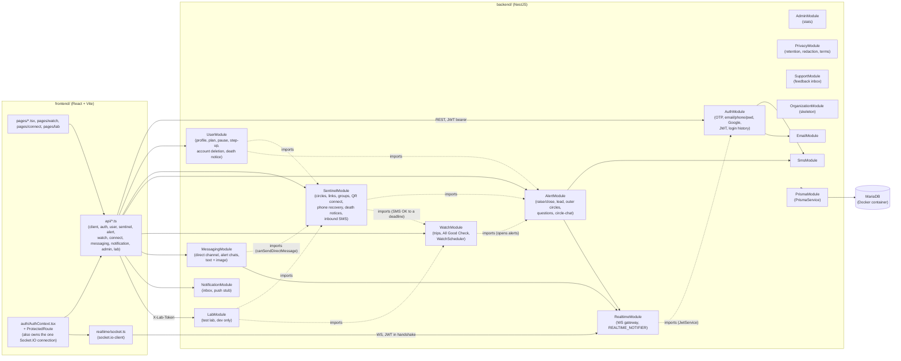

# Stack schema

Updated: 2026-11-11 00:50

Conceptual overview of the whole MySentinelCircle stack — how the pieces fit together. For DB entities/relations see `backend/prisma/DB_schema.md`; for route-by-route detail see `API.md`.

domain name: mysentinelscircles.com.

## Tech stack

- **Backend**: NestJS + TypeScript
- **Frontend web**: React + TypeScript (Vite), i18next for translations
- **Mobile**: React Native (planned, not started)
- **ORM / DB**: Prisma + MariaDB, containerized (self-hosted, not a managed provider like Neon)
- **SMS**: pluggable provider behind an interface (`SMS_SENDER`/`OTP_SENDER`/`EMAIL_SENDER` tokens). Dev senders log to console and, if `NOSMSNOW_URL` is set (`backend/.env`), also forward to NoSMSNow (`nosmsnow/`, a dev-only proxy tool — not a real provider). With `ALLOW_DEV_ROUTES=true`, every SMS sent is also copied into `LabSms` for the test lab. SMS stay plain ASCII (GSM-7, ≤160 characters). One inbound webhook for the whole app, `POST /sentinel/sms/inbound` (a real provider gives one inbound URL per phone number, not one per module) — lets a Sentinel without an account answer by SMS. `SmsInboundService` gathers what waits on that number (invitations, 1st-circle moves, alert questions via `AlertModule`, Watch Mode deadlines via `WatchModule`) and routes the reply: numbered reply codes first (`<category><slot><choice>`, `src/sms/sms-reply-code.ts`), then the older forms (name prefix, OUI/NON/STOP, OK). Twilio likely default in prod.
- **Push**: `PUSH_SENDER` interface, console stub only — real device push (FCM/APNs) needs a native app shell that doesn't exist yet.
- **Scheduled jobs** (`@nestjs/schedule`): `WatchScheduler` every minute (Watch Mode deadlines: reminder, then a linked alert) and every hour (subscription reminders); `OuterCirclesService` every 30 min (one-time nudge when an outer-circle batch has gone quiet); `RetentionService` daily at 3 am (purges old login events, GPS positions, notifications, unclaimed stand-in users).
- **Real-time**: Socket.IO, built (`backend/src/realtime/`, `@nestjs/websockets` + `@nestjs/platform-socket.io`). One gateway, push-only — no `@SubscribeMessage` handlers, clients never send app data over the socket. JWT-authenticated handshake (same secret/payload as `JwtStrategy`, verified manually since the socket.io handshake doesn't go through Nest's HTTP guard pipeline), one room per user (`user:<id>`). `AlertService`/`MessagingService` push through a `REALTIME_NOTIFIER` interface (mirrors the `SmsSender`/`OTP_SENDER` pattern) rather than depending on socket.io directly — `notifyNewMessage`/`notifyAlertChanged` emit a bare id (`message:new { conversationId }`, `alert:changed { alertId }`); the client still calls the existing `GET` endpoints for the actual content, the socket is just the "go refetch" signal, so there's only ever one authorization-aware code path (`getAlert()`) regardless of how a client learned something changed. SMS notifications (`notifyParticipants` in `alert.service.ts`) are unchanged and still go out alongside the WS push, for anyone not connected.
- **Rate limiting**: `@nestjs/throttler`, **implemented**. A single global guard (`ThrottlerModule.forRoot([{ ttl: 60_000, limit: 100 }])` + `APP_GUARD` → `ThrottlerGuard`, in `app.module.ts`) covers every route at 100 req/min/IP. Sign-in/signup/OTP/password/step-up routes are tighter (`@Throttle`, 20 req/min/IP), phone recovery tighter still (5–10/min). `@SkipThrottle()` on `/health`, avatars, message images and the test lab (its four screens poll their SMS). The frontend also shares the few lists almost every page loads for 30 s (`apiGetShared` in `api/client.ts`) to stay under the limit.
  Lesson from transcendance: behind nginx, the backend saw every client as the same IP, so concurrent signups all shared one throttle bucket and got blocked. Fix: nginx must set `X-Forwarded-For`/`X-Real-IP` (done, every `nginx/nginx.conf` location block sets it), NestJS must `app.set('trust proxy', 1)` (done, in `main.ts`). Throttling still keys on IP, not on the target identifier (phone/account) — several real users can legitimately share one IP (school network, hotel Organization Sentinels); not hardened yet. A Cloudflare tunnel (planned for remote testing) would put one more proxy in front: `trust proxy` / `CF-Connecting-IP` must be revisited then, or every tester shares one bucket.
- **API docs**: Swagger (`@nestjs/swagger`), dev-only. `main.ts` mounts `SwaggerModule` at `/docs` guarded by `process.env.NODE_ENV !== 'production'` — never exposed in prod, and not reachable through nginx in Docker mode either (no `location /docs` block; would need one added to the locked `nginx.conf` if ever wanted there). DTOs in `auth` and `user` (and a few shared ones) are decorated with `@ApiProperty()`; the other modules' DTOs aren't yet, so their Swagger schemas are thin.
- **CI**: GitHub Actions, `.github/workflows/backend-ci.yml`. Runs on every push/PR to `main`/`dev`: `npm run lint`, `npm run test` (unit), `npm run test:e2e` — against an ephemeral MariaDB 11 service container (not Sylvie's local Docker), so it never touches real data. See `TEST.md` for the full test strategy (unit vs e2e, local `mysentinelcircle_test` DB, how to run each).
- **Infra**: Docker + `docker-compose` (pattern reused from the transcendance project, adapted — see `PERMISSIONSCLAUDE.md`, these files are now `deny`-locked). Root `docker-compose.yml` runs 4 services: `mariadb` (named volume, persists across restarts), `backend`, `frontend`, `nginx` (reverse proxy, self-signed HTTPS). Two ways to run locally:
  - **Host mode** (`make dev`): backend on `:3000`, frontend on `:5173`, both on the bare host — the original simple flow, still works unchanged.
  - **Docker mode** (`make docker-up`, after `make certs` once): full stack in containers, reachable through nginx at `https://localhost:4444` (HTTP `:8081` redirects to it). `backend`/`frontend` containers publish no ports — only reachable via nginx — so both modes can run at once without colliding, sharing only the `mariadb` container/volume. nginx routes one location block per backend module prefix (`/auth/`, `/user/`, `/sentinel/`, `/alert/`, `/organization/`, `/messaging/`, `/notification/`, `/health`), plus `/uploads/` (avatars and message images, served by the backend's `useStaticAssets`, not nginx itself) and `/socket.io/` (WS upgrade headers set, proxied through to the realtime gateway) straight through to `backend:3000`, no `/api` prefix. The frontend's `VITE_API_URL` is overridden to `""` in Docker mode so every API call (and the socket.io connection) becomes same-origin relative through nginx — no frontend code change needed. Cert is self-signed (`make certs`, gitignored) — browsers show a "not private" warning, expected until a real domain is involved. Since nginx is deny-locked, newer backend features are mounted under an existing prefix rather than a new one: `/user/admin`, `/user/lab`, `/alert/watch`, `/sentinel/connect`.
  **Gotcha, hit for real on 2026-10-28**: `nginx.conf` is baked into the nginx image at build time (`COPY nginx.conf /etc/nginx/nginx.conf` in `nginx/Dockerfile`), not bind-mounted — editing it on disk changes nothing in a running container until `docker compose build nginx && docker compose up -d nginx`. The `/uploads/` block had been committed for months with the image never rebuilt, so avatar uploads (and now message images) silently 404'd-via-frontend-fallback through nginx the whole time despite working fine directly against the backend. If something in `nginx.conf` "isn't working" in Docker mode, check whether the image actually matches the file before suspecting the config itself.
- **Hosting**: 42 Lausanne VM (`vod.42lausanne.ch`) for first tests with real users; planned migration to Infomaniak (Node.js hosting) for the stable public launch — same containerized MariaDB carries over unchanged, Infomaniak includes MariaDB free in that plan.

## High-level diagram

`sms`, `email`, `realtime`, `notification` and `prisma` are global: any module uses them without importing.

## Backend modules

One NestJS module per concern (`backend/src/`), per `plan.txt`'s BACKEND MODULES section:

| Module | Role | Status |
|---|---|---|
| `auth` | Sign-up/sign-in: phone + SMS code, phone or email + password, Google; issues JWT sessions; login history (`LoginEvent`) and "sign out everywhere" (`sessionsValidAfter`). Kept separate from `user` so auth strategies evolve independently of profile data. | Implemented, unit-tested |
| `user` | Profile, language and time zone, avatar, phone/password/email changes, step-up re-authentication before a sensitive action, plan and simulated subscription, pause (for me / for others), terms acceptance, account deletion (`AccountDeletionService`: anonymize, end watches), death notice settings. | Implemented, unit-tested |
| `sentinel` | Circles (incl. the system-managed `FIRST`/`RESERVED`), Sentinel links (invite, request, accept, move, reserve, block, end a whole relationship), groups (`GroupService`), QR code connect (`ConnectService`), lost-phone recovery (`PhoneRecoveryService`), death notices (`DeathNoticeService`), security score. Owns the one inbound-SMS webhook (`SmsInboundService`). | Implemented, unit + e2e tests |
| `alert` | Raise/close an alert (anyone linked can raise; only "Me" or the 1st circle close), Lead claim and leave, status notes and name, live location, requalification of a watch-opened alert; `OuterCirclesService`: questions to outer circles in batches (reply codes by SMS or in-app), further questions, isolated chat with the 1st circle, the quiet-batch nudge. Every change pushes `alert:changed`. | Implemented, unit + e2e tests |
| `watch` | Watch Mode: a watch is an `Alert` in `SENT` for its whole life (shared filters in `common/running-alert.ts` keep it out of every "running alert" count). Trips (steps, travel circles via `TravelCirclesService`, end choices) and All Good Checks (rhythm in the person's time zone, pause). `WatchScheduler` sends reminders at the deadline and opens a linked alert (`AlertService.openAlert`) when it's missed. `WatchViewsService`: what others may see. | Implemented, unit tests; e2e written, not run yet |
| `messaging` | Generic `Conversation` model: the permanent Me<->Sentinel channel (lazily created, allowed between two linked people), the alert-owned chats (1st-circle room, isolated chats) it sends/lists into, and the feedback thread. `TEXT` and `IMAGE` through one `createMessage()`; contact details filtered in alert chats unless allowed. Every send pushes `message:new`. | Implemented, unit + e2e tests |
| `notification` | Persisted inbox per recipient (`Notification`), unread counts, `notification:new` push; `PUSH_SENDER` stub for device push. `@Global()`. | Implemented, unit-tested |
| `realtime` | Socket.IO gateway (push-only) + the `REALTIME_NOTIFIER` interface. JWT-authenticated handshake, one room per user. `@Global()`. | Implemented, unit-tested |
| `privacy` | `RetentionService` (daily purges, nLPD/GDPR), log redaction, current terms version. | Implemented, unit-tested |
| `support` | The feedback inbox: an ordinary account (`SUPPORT_EMAIL`); feedback is a direct conversation with it. | Implemented, unit-tested |
| `admin` | `AdminGuard` (`ADMIN_EMAILS`) and anonymous counts for the Admin page. | Implemented |
| `lab` | Test lab for remote testers, only with `ALLOW_DEV_ROUTES=true`: sets of four phones per tester, SMS copies, reply as a phone, advance time, reset running alerts, feedback with screenshot. | Implemented, no unit tests yet |
| `health` | `GET /health` for the uptime check. | Implemented |
| `organization` | Organization-raised alerts (see `plan.txt`). | Skeleton |
| `sms` / `email` | Pluggable senders (console in dev), SMS texts in each person's language (`messages.ts`), reply codes. | Implemented, unit-tested |
| `prisma` | `PrismaService`, injected everywhere. | Implemented |

Skeleton = empty controller/service, module wired into `app.module.ts` but no logic yet.

## Frontend structure

- `pages/` — one component per route: sign-in/sign-up/recovery pages (`LoginPage`, `SignupPage`, `OtpVerifyPage`, `ForgotPasswordPage`, `ResetPasswordPage`, `NewPasswordPage`, `RecoverPhonePage`, `ConfirmEmailChangePage`, `WelcomePage`, `legal/`), the app (`DashboardPage`, `SentinelHomePage`, `CirclesPage`, `NewCirclePage`, `CompanionsPage`, `NewCompanionPage`, `PersonPage`, `RaiseAlertPage`, `RunningAlertPage`, `AlertChatPage`, `AlertsPage`, `HistoryPage`, `MessagesPage`, `ConversationPage`, `SettingsPage`, `PlansPage`, `FeedbackPage`, `InfoPage`, `AdminPage`), `watch/` (Mode veille: `WatchModePage`, `NewTripPage`, `TripPage`, `ValidateStepPage`, `AllGoodPage`, `EndTripPage`), `connect/` (QR code: `ConnectPage`, `ConnectPersonPage`), `lab/` (`LabPage`, `LabFramePage`).
- `auth/` — `AuthContext` (JWT/session, the single Socket.IO connection), `ProtectedRoute` (remembers a `/connect/*` link across sign-in), `afterLogin`.
- `realtime/` — `socket.ts` (`createSocket(token)`), `useSocketEvent`.
- `api/client.ts` — thin `fetch` wrapper (`apiGet/Post/Patch/Delete/PostForm`, `apiGetShared` for 30 s shared lists), bearer token from `localStorage` (one key per lab frame), `ApiError`. One typed file per backend area: `auth`, `user`, `sentinel`, `alert`, `watch`, `connect`, `messaging`, `notification`, `admin`, `lab` (its own fetch with `X-Lab-Token`).
- `components/` — shared UI (`AppShell`, `BottomNav`, `UserMenu`, `Tile`, `Modal`, `StepUp`, `Upgrade` — gold star + subscription popup for paid features, `ConversationThread`, alert panels…), `components/watch/`, `components/connect/` (`QrScanner` with `jsqr`, QR drawn with `qrcode-generator` — no outside service).
- Shared hooks: `useLoad`, `useAction`. `i18n/` — i18next + `locales/fr.json` / `en.json`.

## How frontend and backend connect

- Frontend calls the backend over REST at `VITE_API_URL` (defaults to `http://localhost:3000` in host mode; `""` in Docker mode so calls are same-origin through nginx). Backend CORS is locked to `FRONTEND_URL` (only exercised in host mode).
- Auth: sign-in flows hit `auth`, get back a JWT stored in `localStorage` and sent as a bearer token; `JwtAuthGuard` + `JwtStrategy` protect routes backend-side, `ProtectedRoute` gates pages frontend-side. Sensitive actions need a fresh step-up.
- Test lab: `/lab` signs a tester in with their own account and gets a lab token (`X-Lab-Token`); each phone is an iframe named `lab-<name>` with its own JWT (`msc_token:<frame>`), so four people are signed in side by side in one browser.
- Real-time: Socket.IO — `AuthContext` connects once per session; pages listen for `message:new` / `alert:changed` / `notification:new` and refetch over REST rather than trusting the socket payload.
- All modules share one `PrismaService` → one MariaDB database, containerized alongside backend/frontend/nginx via `docker-compose`.

## Regenerating this file

Run `/docu stack`. Keep it conceptual — update `API.md` (`/docu api`) for endpoint-level detail and `backend/prisma/DB_schema.md` (`/docu prisma`) for entity/relation detail.
